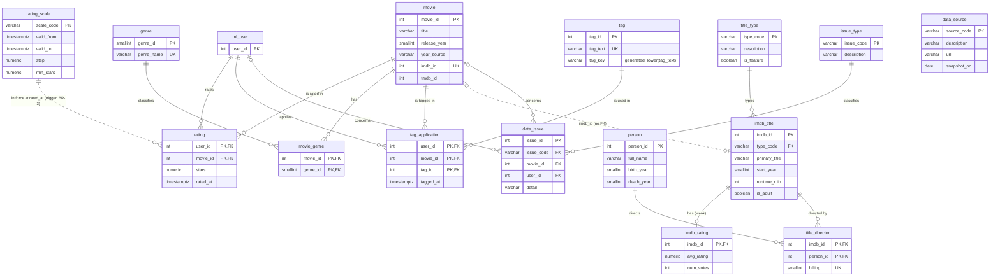

# Schema and data dictionary

The database `movielens` (schema `movielens`, PostgreSQL 18) holds **16 base tables** in three groups, plus a derived layer of materialized views and views, and 6 tables written by the analytics. Row counts are from the full load (MovieLens 32M, IMDb snapshot of 30 Oct 2026). DDL: [02_ddl.sql](02_ddl.sql); rules and views: [03_logic.sql](03_logic.sql); analytics tables: [07_analytics.sql](07_analytics.sql). Design reasoning (business rules BR-1 to BR-12, EER, normalization): [01_design.md](01_design.md).

| Group | Tables | What it holds |
|---|---|---|
| **MovieLens core** | `ml_user`, `movie`, `rating`, `genre`, `movie_genre`, `tag`, `tag_application` | Who rated and tagged which film, when, and how |
| **IMDb side** | `imdb_title`, `imdb_rating`, `title_type`, `person`, `title_director` | The second source, linked through `movie.imdb_id` |
| **Rules and provenance** | `rating_scale`, `data_source`, `issue_type`, `data_issue` | The star scale over time, where the data came from, and suspicious records |

## 1. Entity-relationship diagram



Reading the diagram: `||--o{` is one-to-many, `|o--o|` one-to-at-most-one; a dotted line is a link **without** a foreign key. `rating_scale` is joined to `rating` by time (the scale whose period contains `rated_at`), which a FK cannot express, so a trigger enforces it.

## 2. From the source files to the tables

| Source file | Columns in the file | Goes to |
|---|---|---|
| `movies.csv` | movieId, title, genres | `movie` (title split from "(yyyy)"), `movie_genre` (one row per genre in "A\|B\|C"), `genre` |
| `links.csv` | movieId, imdbId, tmdbId | `movie.imdb_id`, `movie.tmdb_id` |
| `ratings.csv` (32M lines) | userId, movieId, rating, timestamp | `ml_user`, `rating` (Unix seconds → `timestamptz` UTC) |
| `tags.csv` | userId, movieId, tag, timestamp | `tag` (distinct trimmed text), `tag_application` |
| IMDb `title.basics.tsv.gz` | tconst, titleType, primaryTitle, isAdult, startYear, runtimeMinutes, … | `imdb_title` (only titles MovieLens links to), `title_type` |
| IMDb `title.ratings.tsv.gz` | tconst, averageRating, numVotes | `imdb_rating` |
| IMDb `title.crew.tsv.gz` | tconst, directors | `title_director` (billing = position in the list) |
| IMDb `name.basics.tsv.gz` | nconst, primaryName, birthYear, deathYear | `person` (directors only) |

IMDb ids are stored as integers: `tt0114709` → `imdb_id = 114709`, `nm0005124` → `person_id = 5124`.

## 3. Tables

Notation: **PK** primary key, **FK** foreign key, **UK** unique, **NN** not null. All timestamps are UTC.

### MovieLens core

#### `ml_user` — 200,948 rows
One row per anonymous MovieLens user. The dataset gives no attributes, so there are none (we do not invent demographics).

| Column | Type | Constraints | Meaning |
|---|---|---|---|
| user_id | integer | PK | MovieLens userId |

Rule BR-4 (every user has ≥ 20 ratings) is enforced on `rating` by statement-level triggers.

#### `movie` — 87,585 rows
One row per film in the MovieLens catalogue.

| Column | Type | Constraints | Meaning | Example |
|---|---|---|---|---|
| movie_id | integer | PK | MovieLens movieId | 1 |
| title | varchar(300) | NN, trimmed, non-empty | Title with the "(yyyy)" suffix removed | Toy Story |
| release_year | smallint | 1870–2030 | From the title; else IMDb's start year (BR-6) | 1995 |
| year_source | varchar(5) | 'TITLE' or 'IMDB'; NULL exactly when the year is NULL | Where the year came from | TITLE |
| imdb_id | integer | NN, UK; **no FK** | Link to `imdb_title` (228 ids are no longer in IMDb) | 114709 |
| tmdb_id | integer | indexed, not unique | The Movie Database id (36 ids are shared by two films) | 862 |

618 titles carry no year in the title; IMDb fills 611 of them and 7 stay unknown.

#### `rating` — 32,000,204 rows (2.5 GB with indexes)
One row per (user, film) rating: an M:N relationship with attributes.

| Column | Type | Constraints | Meaning | Example |
|---|---|---|---|---|
| user_id | integer | PK, FK → ml_user | Who rated | 194343 |
| movie_id | integer | PK, FK → movie; indexed (`ix_rating_movie`) | Which film | 4995 |
| stars | numeric(2,1) | 0.5–5.0 in half steps (`ck_rating_stars`, BR-1) | The rating | 4.0 |
| rated_at | timestamptz | 1995-01-01 ≤ t < 2023-10-14 (`ck_rating_time`, BR-8) | When | 2017-04-29 08:51:41 |

PK `(user_id, movie_id)`: a user rates a film once (BR-2). Triggers: `rating_scale_ins/upd` (stars must fit the scale in force at `rated_at`, BR-3), `user_min_ratings_ins/del` (BR-4), `rating_identity` (a rating never moves to another user or film, BR-5).

#### `genre` — 19 rows
Action, Adventure, Animation, Children, Comedy, Crime, Documentary, Drama, Fantasy, Film-Noir, Horror, IMAX, Musical, Mystery, Romance, Sci-Fi, Thriller, War, Western.

| Column | Type | Constraints |
|---|---|---|
| genre_id | smallint | PK |
| genre_name | varchar(20) | NN, UK |

#### `movie_genre` — 147,090 rows
The multivalued `genres` field of `movies.csv`, as rows (1NF). 7,080 films have no genre.

| Column | Type | Constraints |
|---|---|---|
| movie_id | integer | PK, FK → movie (ON DELETE CASCADE) |
| genre_id | smallint | PK, FK → genre; indexed |

#### `tag` — 140,525 rows
Distinct tag texts.

| Column | Type | Constraints | Meaning | Example |
|---|---|---|---|---|
| tag_id | integer | PK | Surrogate key | 26479 |
| tag_text | varchar(300) | NN, UK, trimmed, non-empty (BR-10) | The tag as typed | Kevin Kline |
| tag_key | varchar(300) | **generated**: `lower(tag_text)` | Case-folded concept, used for grouping | kevin kline |

#### `tag_application` — 2,000,051 rows
Who applied which tag to which film: a ternary relationship.

| Column | Type | Constraints | Example |
|---|---|---|---|
| user_id | integer | PK, FK → ml_user | 1 |
| movie_id | integer | PK, FK → movie; indexed | 22 |
| tag_id | integer | PK, FK → tag; indexed | 26479 |
| tagged_at | timestamptz | NN, inside the dataset window | 2020-03-01 05:01:26 |

### IMDb side

#### `imdb_title` — 87,357 rows
IMDb titles that MovieLens links to (filtered from the full IMDb file while streaming it).

| Column | Type | Constraints | Example |
|---|---|---|---|
| imdb_id | integer | PK | 114709 |
| type_code | varchar(14) | NN, FK → title_type | movie |
| primary_title | varchar(450) | NN | Toy Story |
| start_year | smallint | 1870–2030 | 1995 |
| runtime_min | integer | > 0 | 81 |
| is_adult | boolean | NN | false |

#### `imdb_rating` — 87,231 rows
Weak entity: exists only with its title.

| Column | Type | Constraints | Example |
|---|---|---|---|
| imdb_id | integer | PK, FK → imdb_title (ON DELETE CASCADE) | 114709 |
| avg_rating | numeric(3,1) | 1–10 | 8.3 |
| num_votes | integer | ≥ 5 | 1,205,094 |

#### `title_type` — 11 rows
movie, tvMovie, video (these three `is_feature = true`), short, tvShort, tvSpecial, tvEpisode, tvMiniSeries, tvSeries, tvPilot, videoGame.

| Column | Type | Constraints |
|---|---|---|
| type_code | varchar(14) | PK |
| description | varchar(40) | NN |
| is_feature | boolean | NN |

#### `person` — 40,116 rows
Directors of the linked titles.

| Column | Type | Constraints | Example |
|---|---|---|---|
| person_id | integer | PK (IMDb nconst number) | 5124 |
| full_name | varchar(200) | NN | John Lasseter |
| birth_year | smallint | | 1957 |
| death_year | smallint | ≥ birth_year | |

#### `title_director` — 99,349 rows
Who directed which title, in credit order.

| Column | Type | Constraints | Example |
|---|---|---|---|
| imdb_id | integer | PK, FK → imdb_title (ON DELETE CASCADE) | 114709 |
| person_id | integer | PK, FK → person; indexed | 5124 |
| billing | smallint | ≥ 1; UK with imdb_id | 1 |

### Rules and provenance

#### `rating_scale` — 2 rows
A valid-time table: which star scale was in force when.

| scale_code | valid_from | valid_to | step | min_stars |
|---|---|---|---|---|
| WHOLE | 1995-01-01 00:00:00 | 2003-02-18 21:34:27 | 1.0 | 1.0 |
| HALF | 2003-02-18 21:34:27 | 2100-01-01 00:00:00 | 0.5 | 0.5 |

`EXCLUDE USING gist (tstzrange(valid_from, valid_to) WITH &&)`: two scales can never overlap in time. The switch instant is read from the data by the loader (the first half-star rating).

#### `data_source` — 2 rows

| source_code | description | snapshot_on |
|---|---|---|
| ML32M | MovieLens 32M (GroupLens, University of Minnesota) | 2023-10-13 |
| IMDB | IMDb non-commercial datasets (title.basics, title.ratings, title.crew, name.basics) | 2026-10-30 |

#### `issue_type` — 7 rows and `data_issue` — 2,305 rows
Suspicious but real records are kept, and the reason is recorded (BR-12). `data_issue` is filled by `refresh_research()`.

| issue_code | Meaning | Cases |
|---|---|---|
| YEAR_MISMATCH | Title year and IMDb start year differ by more than one year | 1,020 |
| NO_YEAR | Title has no "(yyyy)"; year from IMDb or unknown | 618 |
| BULK_RATING | User entered 100+ ratings within one second | 310 |
| IMDB_MISSING | Linked IMDb id not in the current IMDb snapshot | 228 |
| SHARED_TMDB | Two films point to the same TMDb id | 72 |
| POWER_USER | User has more than 5,000 ratings | 36 |
| PRE_RELEASE | Rated more than a year before the release year | 21 |

`data_issue(issue_id PK, issue_code FK → issue_type, movie_id FK → movie, user_id FK → ml_user, detail)`, with `CHECK (movie_id IS NOT NULL OR user_id IS NOT NULL)`.

## 4. Derived layer (never stored as base data, BR-11)

| Object | Kind | Rows | Columns |
|---|---|---|---|
| `mv_movie_stats` | materialized view | 84,432 | movie_id, n_ratings, mean_stars, sd_stars, n_likes (≥ 4 stars), first_rated, last_rated |
| `mv_user_stats` | materialized view | 200,948 | user_id, n_ratings, mean_stars, sd_stars, first_rated, last_rated, n_half_stars |
| `v_movie` | view | 87,585 | movie + stats + `bayes_stars` (shrunk to the global mean, prior 50) + IMDb type, runtime, rating, votes |
| `v_movie_genre` | view | 147,090 | movie_id, genre_name |
| `v_user_features` | view | 200,948 | user_id and the 7 k-means features: ln_ratings, mean_stars, sd_stars, mainstream, classic_share, conformity, half_share |
| `v_segment_profile` | view | 4 | segment_name, users, avg_ratings, avg_stars |

The materialized views are refreshed by `CALL refresh_research()`; until then they are stale (shown in `06_demo.sql`, step 6).

## 5. Analytics tables (written by `07_analytics.sql` and the notebook)

| Table | Rows | Key | Holds |
|---|---|---|---|
| `rec_item` | 2,000 | movie_id → movie | The recommender's catalogue: the most-liked films before 2021, with train_likes |
| `rec_neighbor` | 100,000 | (movie_id, neighbor_id) → rec_item | Top 50 similar films per film: co_likes, cosine (0–1] |
| `rec_test_user` | 459 | user_id → ml_user | Users evaluated on their ratings after 1 Jan 2021 |
| `rec_list` | 13,765 | (method, user_id, rank) | Top-10 lists for POPULAR, TOP_RATED, ITEM_KNN |
| `segment` | 4 | segment_id; segment_name UK | Cinephiles, 1990s Pioneers, Easy Pleasers, Tough Critics, with descriptions |
| `user_segment` | 200,948 | user_id → ml_user | Each user's segment and distance to its centroid |

## 6. One film through the tables

*Toy Story* (MovieLens id 1) as it is stored:

```
movie           (1, 'Toy Story', 1995, 'TITLE', 114709, 862)
movie_genre     (1, Adventure) (1, Animation) (1, Children) (1, Comedy) (1, Fantasy)
imdb_title      (114709, 'movie', 'Toy Story', 1995, 81, false)
imdb_rating     (114709, 8.3, 1205094)
title_director  (114709, 5124, 1)  →  person (5124, 'John Lasseter', 1957, NULL)
rating          68,997 rows with movie_id = 1     →  mv_movie_stats: mean 3.897
```

## 7. Indexes

Besides the primary keys and unique constraints: `ix_rating_movie (rating.movie_id)`, `ix_movie_tmdb`, `ix_movie_genre_genre`, `ix_tagapp_movie`, `ix_tagapp_tag`, `ix_director_person`, `ix_issue_code`, and unique indexes on both materialized views. `08_optimizer.sql` measures what `ix_rating_movie` is worth (0.8 s vs 3.6 s for one film's ratings) and compares BRIN with B-tree.
